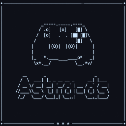
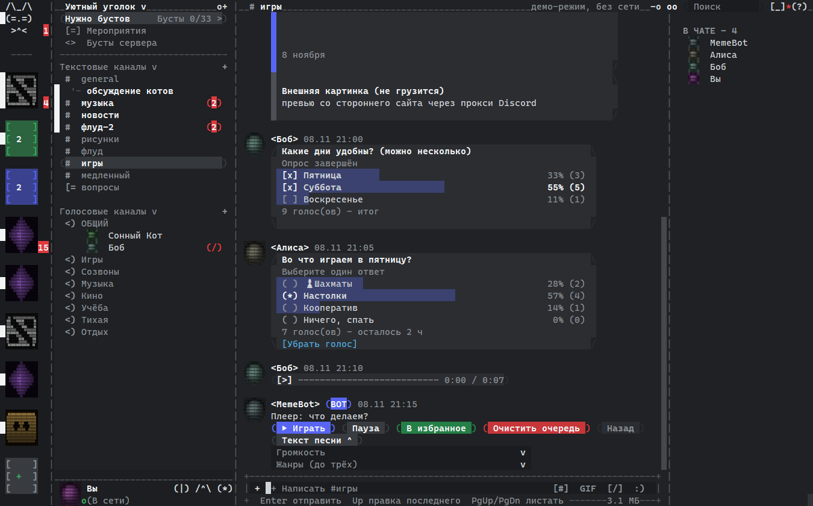
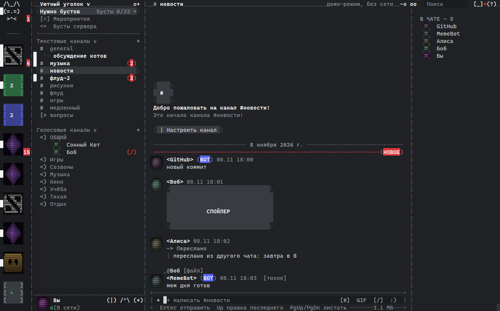
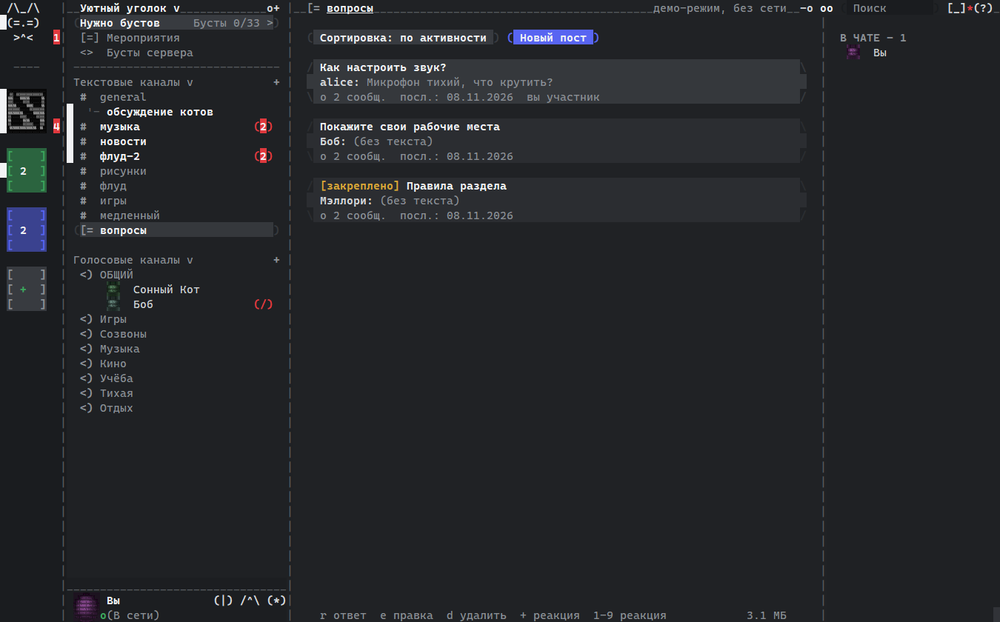
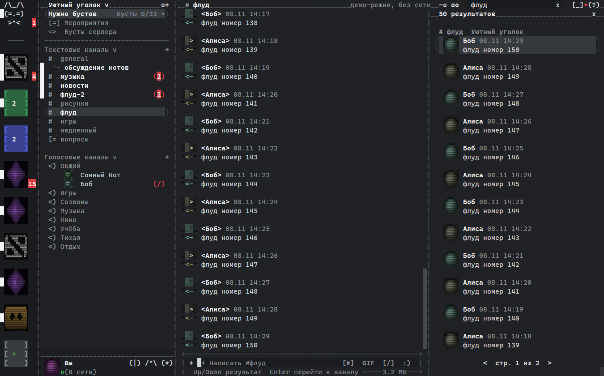
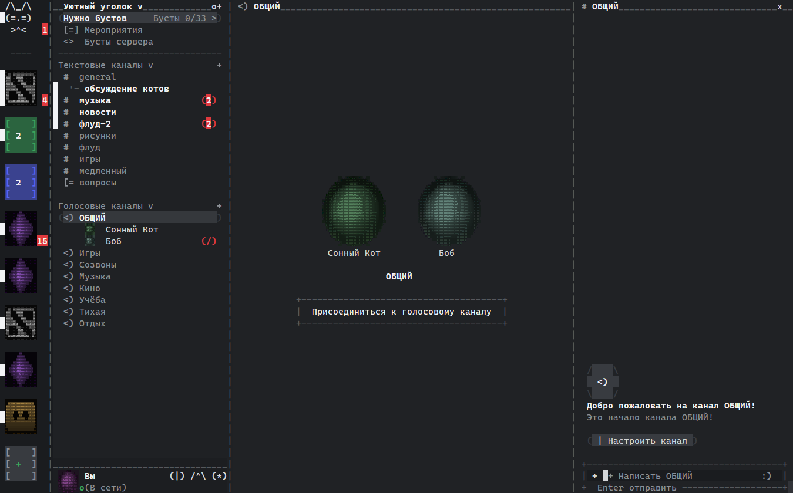
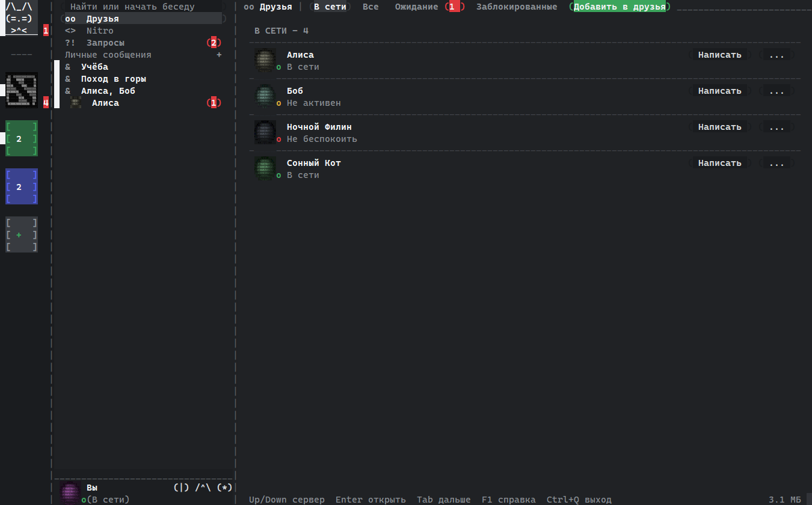
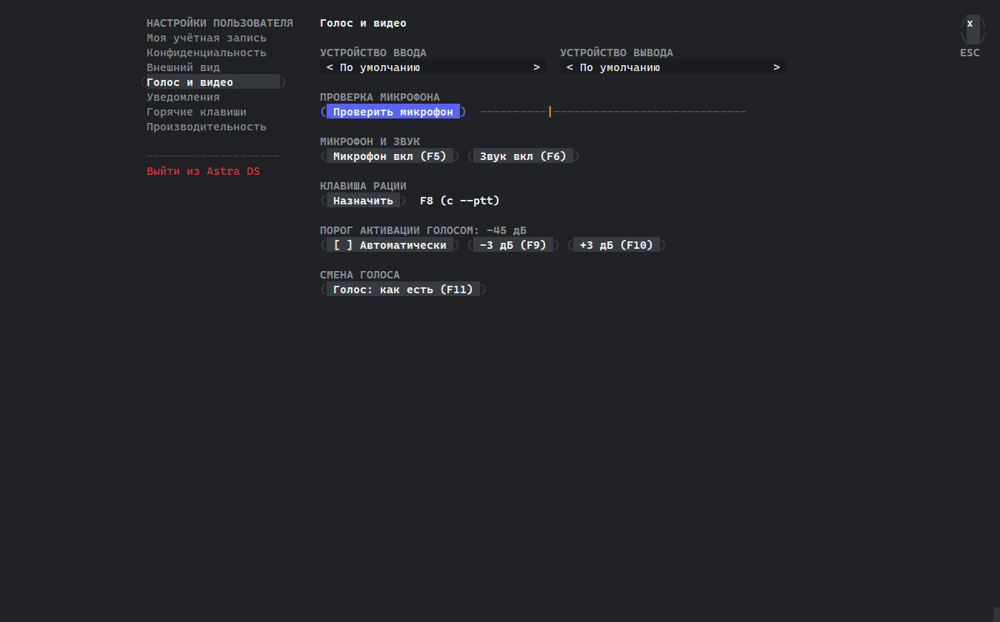
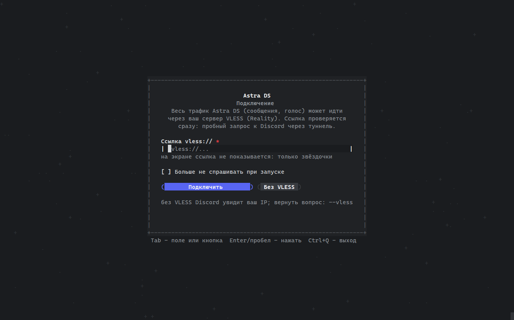

<div align="center">



# Astra DS

**Клиент Discord на C, которому хватает около 3 МБ памяти.**

C11 · Windows и Linux · без Electron, без браузера, без GPU




*Окно в стиле Discord, нарисованное цветными символами: опросы, голосовое сообщение, кнопки бота и карточка ссылки. Всё на выдуманных данных демо-режима.*

</div>

> [!WARNING]
> **Сторонние клиенты нарушают правила Discord**, и аккаунт за них могут заблокировать.
> Пользуйтесь на свой риск, лучше с запасного аккаунта. Проект никак не связан с Discord Inc.
> Чтобы просто посмотреть, запустите `astra-ds --demo`: там выдуманные данные и нет сети.

### Если Discord заблокировал аккаунт

Discord отключает аккаунт или требует сменить пароль, когда принимает его за бота или считает взломанным. Такое бывает с любым клиентом, но со сторонними чаще. Обычно это вызывают:

- вступление на серверы и выход из них;
- частые переподключения, то есть много перезапусков подряд;
- новые личные беседы с незнакомыми людьми;
- изменения в списке друзей.

**Входите по почте и паролю.** Если включена двухфакторная аутентификация, после пароля введите код из приложения. Вход по QR-коду сейчас работает нестабильно: Discord может запросить проверку (капчу) и не принять её. Так же он ведёт себя и в браузере, так что это не ошибка Astra DS.

Всё это лучше делать в официальном клиенте. Вступить на сервер по приглашению Astra DS всё равно предложит через браузер: Discord требует для этого официальный клиент. Если аккаунт заблокировали, смените пароль на discord.com, а если не помогло, [напишите в поддержку](https://support.discord.com/hc/en-us/requests/new?ticket_form_id=360000029731).

### Если ругается антивирус

Сборка для Windows не подписана, поэтому SmartScreen предупреждает о ней. Антивирус может принять любой клиент Discord за похитителя токенов: в коде те же слова, «token» и «Authorization». Токен уходит только в Discord и лежит в системном хранилище (Диспетчер учётных данных в Windows, Secret Service в Linux). Код открыт, его можно прочитать и собрать самому. Скачивайте Astra DS только из этого репозитория.

## Зачем

Официальный Discord устроен как целый браузер внутри программы. Для сравнения:

| | Память в простое | Процессор в простое | Файл программы |
|---|---|---|---|
| Discord (Electron) | обычно 300-600 МБ¹ | заметно выше нуля | сотни МБ |
| [larperCord](https://github.com/RshaCuDeVidro/larperCord) (Zig, SDL3) | ~130 МБ² | 0-0,4%² | ~14 МБ |
| **Astra DS** | **~2,9 МБ**³ | **0%** | **~13 МБ** |

<sub>¹ Оценка по Диспетчеру задач, зависит от числа серверов. Мы её не мерили рядом.
² По данным README larperCord, не наш замер.
³ Частная память процесса, Windows 11: медиана пяти запусков, окно 140x40 клеток, ожидание 2 с. Канал с картинками 2,9-3,1 МБ, голосовой звонок со сквозным шифрованием 4-5 МБ.</sub>

Как этого удалось добиться:

- **один поток и никакого опроса в цикле.** Программа спит, пока не придёт событие, поэтому в простое 0% процессора;
- **ничего лишнего в памяти.** События Discord, которые клиенту не нужны, отбрасываются, не разбираясь. Данные при входе разбираются по одному серверу;
- **картинки рисуются на лету** из маленьких превью и нигде не хранятся;
- **голос живёт только во время звонка.** Потоки, кодеки и шифрование создаются при входе и полностью удаляются при выходе;
- **тяжёлое загружается по требованию.** Эмодзи серверов, слеш-команды, форумы и профили приходят, когда их открыли, и освобождаются, когда закрыли.

## Что умеет

По описи из 162 экранов и функций Discord готово **86%** (84%, если не считать частично готовое).

- **Сообщения.** Отправка, ответы (с упоминанием автора и без), правка, удаление, реакции, тихие сообщения, пересылка, черновики по каналам. Неотправленное сообщение показывается серым, а если не ушло, его можно повторить.
- **Разметка Discord.** Жирный, курсив, зачёркнутый, код, блоки кода с кнопкой «Копировать», заголовки, списки, цитаты, спойлеры. Ссылка вида `[текст](адрес)` показывает настоящий адрес, если он не совпадает с текстом.
- **Вложения.** Картинки и аватарки цветным ASCII, просмотр на весь экран, превью текстовых файлов, голосовые сообщения (воспроизведение потоком), отправка файлов до 10 МБ со спойлером и описанием, перетаскивание файла в окно.
- **Боты.** Метка BOT, кнопки и меню, слеш-команды с вводом опций, карточки ссылок, опросы с голосованием.
- **Серверы.** Каналы по категориям с учётом прав, папки серверов, ветки и форумы (создать, вступить, архив, новый пост), закреплённые сообщения, медленный режим с отсчётом.
- **Управление.** Создать, изменить, покинуть или удалить сервер. Каналы и категории: создать, переименовать, переставить, настроить права. Модерация для тех, у кого есть права: тайм-аут, кик, бан, роли, перенос в голосовом.
- **Люди.** Друзья со статусами, заявки, блокировка, игнор, личные заметки, полный профиль, группы в ЛС. Запросы на переписку и спам отдельно от ЛС, и картинки в них не загружаются, пока вы не ответили.
- **Голос.** Голосовые каналы, звонки в ЛС и группах. Сквозное шифрование DAVE обязательно: без него ваш голос не отправляется. Громкость каждого участника, выбор микрофона и динамиков, тест микрофона, автоматический порог, рация на любой клавише или боковой кнопке мыши, смена голоса.
- **Навигация.** Вкладки каналов, быстрый переход Ctrl+K, поиск с фильтрами `from:` `in:` `has:` `before:` `after:`, «Входящие» с упоминаниями, ссылки на сообщения Discord открываются внутри программы.
- **Удобство.** Масштаб Ctrl+= и Ctrl+-, полный экран Alt+Enter, ширина колонок мышью, уведомления и значок в трее, режим фокуса, слова-тревоги, фильтр слов.
- **Три режима.** Окно с мышью, полноэкранный режим в терминале (`--tui`) и построчный режим как IRC (`--cli`).

**Видео** есть в отдельной сборке **Astra DS Video**. В обычной сборке этого кода нет совсем, поэтому она остаётся такой же лёгкой.

- **Демонстрация экрана.** Весь экран или одно окно, 1280x720, 30 кадров в секунду. На Windows со звуком программы. На Linux работает и в X11, и в Wayland (GNOME, KDE, sway и другие, через системное окно выбора источника), пока без звука.
- **Просмотр чужих трансляций** в голосовом канале и в звонке.
- **Камера**: своя и камеры собеседников, плитками и крупно (Alt+стрелки, Alt+F). Включение кнопкой `[]/`, F12 или Alt+C.
- **Скрытие глаз на своей камере.** Программа находит лицо в каждом кадре и закрывает глаза плашкой из шума и случайных символов. Если лицо не найдено или программа в нём не уверена, собеседники вместо кадра видят логотип Astra DS, а вы в предпросмотре надпись «Лицо не найдено». Включено по умолчанию, выключается Alt+E или флажком в окне «Камера». Всё считается на вашем компьютере, кадры никуда, кроме звонка, не уходят.

**Чего нет:** анимированные GIF, плагины.

## Приватность и безопасность

- **Никаких журналов, кэша и телеметрии.** На диск попадает только токен, и то в системное хранилище.
- **Токен в закреплённой памяти**, которая не уходит в подкачку и не попадает в дампы.
- **Свой сервер VLESS (Reality)** для всего трафика, включая голос. Если туннель не работает, программа не уходит молча напрямую, а спрашивает.
- **Режим стримера** прячет почту, адрес сервера VLESS, ссылки-приглашения, пути к файлам и текст ЛС.
- **Паник-кнопка:** тройное нажатие стирает токен, закрывает программу и чистит экран.
- **Капча** открывается прямо в окне программы, и действие повторяется само.
- **Уведомления без подробностей.** По умолчанию в них только «новое сообщение»: Windows хранит историю уведомлений на диске.
- **Всё из сети проверяется.** Управляющие символы и символы смены направления текста вырезаются, разбор данных проверен фаззерами (`tools/sec/`).

## Как выглядит

<table>
<tr>
<td></td>
<td></td>
</tr>
<tr>
<td align="center">Боты, спойлер и пересланное сообщение</td>
<td align="center">Форум</td>
</tr>
<tr>
<td></td>
<td></td>
</tr>
<tr>
<td align="center">Поиск со страницами</td>
<td align="center">Голосовой канал</td>
</tr>
<tr>
<td></td>
<td></td>
</tr>
<tr>
<td align="center">Друзья, группы и запросы</td>
<td align="center">Настройки голоса</td>
</tr>
<tr>
<td colspan="2"></td>
</tr>
<tr>
<td colspan="2" align="center">Стартовый экран: подключение через VLESS с галочкой «Больше не спрашивать»</td>
</tr>
</table>

## Скачать

Готовые сборки для Windows 10/11 и Linux лежат в [релизах](../../releases/latest): обычная и Astra DS Video. Для Windows это один exe без установки, для Linux нужны glibc 2.36+, `libasound2` и `libx11-6`. Чтобы на Linux открывалось окно капчи, поставьте `libwebkit2gtk-4.1-0`. Для демонстрации экрана в Wayland нужны `xdg-desktop-portal` и PipeWire, они уже есть в обычных дистрибутивах. Можно собрать и самому, см. ниже.

## Полезные флаги

```
--demo            демо на выдуманных данных, без сети
--tui             полноэкранный режим в терминале
--cli             построчный режим, как IRC
--no-save         не сохранять токен, вводить при каждом запуске
--logout          удалить сохранённый токен и выйти
--no-images       не загружать картинки и аватарки
--vless           указать или сменить свой сервер VLESS
--panic=F12       паник-кнопка (тройное нажатие)
--invisible       входить невидимым
--no-ack          не отмечать сообщения прочитанными
--ptt             рация вместо активации голосом
--tray            сворачивать в трей (Windows)
--hq              голос качественнее ценой процессора
--devices         показать звуковые устройства
--selftest        самопроверка без сети
```

## Сборка

**Windows** (нужны WinLibs GCC, CMake, Ninja и Git for Windows):

```
bash deps/build-deps.sh     # один раз: собрать зависимости из исходников
bash build.sh               # готово: build/astra-ds.exe
```

**Linux** (Debian или Ubuntu):

```
sudo apt install build-essential cmake ninja-build perl git curl xz-utils libasound2-dev libx11-dev pkg-config
bash deps/build-deps.sh
bash build.sh               # готово: build/astra-ds
```

Зависимости (zlib, OpenSSL, curl, opus, libdave и другие) собираются из исходников с проверкой контрольных сумм и компонуются статически. Исключение одно: готовая библиотека libcurl-impersonate из `third_party/impcurl/`, через неё идут только запросы входа. Она встроена внутрь программы, отдельным файлом рядом не лежит. Сборка с демонстрацией экрана: `VIDEO=1 bash build.sh`.

Проверить, что всё работает: `build/astra-ds --selftest`. Это больше 400 проверок интерфейса, разбора данных, голоса и безопасности без выхода в сеть.

## Как устроен код

| Файл | Что внутри |
|---|---|
| `src/ui.c` | интерфейс: раскладка как у Discord, мышь и клавиатура |
| `src/gui_win.c`, `gui_x11.c`, `gui_grid.c` | окно-сетка символов для Windows и Linux |
| `src/store.c` | модель данных, права, события Discord |
| `src/net.c` | запросы к Discord и постоянное соединение |
| `src/voice.c`, `voicefx.c` | голос, шифрование DAVE, голосовые сообщения, смена голоса |
| `src/img.c` | картинки в цветной ASCII |
| `src/login.c`, `captcha.c` | вход, QR-код, капча |
| `src/vless.c`, `xlite_c.c`, `tls13.c` | туннель VLESS |
| `src/secret.c`, `panic.c` | защищённая память и паник-кнопка |
| `src/selftest.c` | самопроверка |
| `tools/sec/` | фаззеры и стенды безопасности |
| `tools/uitest/` | проверка всех окон по скрытым снимкам |

## Поддержать проект

Немного обо мне. Три года я работал Java-разработчиком, потом потерял работу. Дважды пытался открыть своё дело, оба раза неудачно, и в итоге остался с кредитами: сейчас долг около 240 тысяч. Параллельно переучиваюсь на новую профессию, Go-разработчика.

Поэтому для меня важна любая помощь, даже совсем небольшая. Если Astra DS вам пригодился и хочется поддержать меня и развитие проекта, можно отправить пожертвование в USDT (сеть TRON, TRC-20):

```
TXxTPQ14xbxrr2D6HeG3d27K3fm8kaKWus
```

Отправляйте только USDT в сети TRC-20: другие монеты и сети на этот адрес потеряются. Спасибо!

## Автор

Привет! Я Flaim92, и сейчас я ищу работу **Go-разработчиком**. Если вам нужен человек, который любит выжимать из кода максимум и не боится низкого уровня, напишите мне: [flaim922@gmail.com](mailto:flaim922@gmail.com).

Вопросы, идеи и найденные ошибки по Astra DS тоже присылайте на почту или в [Issues](../../issues).

## Лицензия

GPL-3.0, текст в файле [LICENSE](LICENSE). Сторонний код в `third_party/` распространяется под своими лицензиями: cJSON (MIT) и заголовок WebView2 (BSD-подобная лицензия Microsoft). Шумоподавление микрофона сделано на SpeexDSP и RNNoise (Xiph.Org, BSD-3): они собираются из исходников и компонуются статически, тексты их лицензий лежат в `third_party/LICENSE`.

Astra DS не связан с Discord Inc. Discord является товарным знаком Discord Inc.
